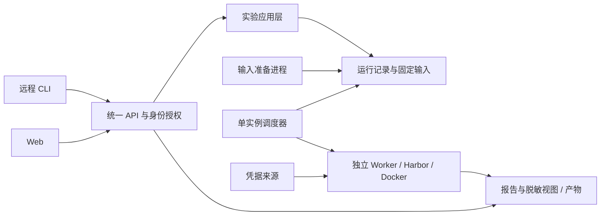

# CLI 与 Web 共用的编排服务

本页保留该阶段的通用设计讨论；设计、实现和实际验收结论分别记录。

建议把实验能力提供为一个长期运行的编排服务，让远程 CLI 与 Web 使用同一 API、同一队列和同一批运行记录。现有 Harbor 执行、快照、评分、对比与清理继续复用；新增工作主要是多用户身份、操作权限和服务生命周期。

## 1. 目的、场景与成功标准

已确认的要求：保留 CLI 使用方式，增加 Web，让其他用户完成现有的提交、过程观测和结果操作。用户没有要求开放注册、分布式执行或商业计费。

典型使用过程：成员登录，选择有权限的数据集及版本、模型方案和候选 bundle，提交后获得受理记录；任务准备完成后进入全局队列。成员关闭网页或断开终端后，任务继续执行。再次登录可以查看状态、脱敏日志、评分与产物，取消自己的任务，比较可比实验，或按原快照重跑。

成功标准：

- CLI 提交的同一 run 可在 Web 查看、取消和报告；Web 提交的 run 可在 CLI 使用同样的操作。
- 两个入口共享容量、版本固定、评分有效性和清理规则，不形成两套队列。
- 登录后的普通成员无需 SSH 登录执行机、设置 state 路径、操作调度器或注入进程环境。
- 用户只能访问授权范围内的记录、日志、产物和凭据；猜测 run ID 也不能扩大访问权限。
- API/网页重启不终止已受理实验，网络重试不重复创建实验或重复调用模型。

## 2. 范围、预算、假设与待决项

| 类别 | 当前结论 |
| --- | --- |
| 已确认 | CLI + Web、其他用户使用、复用现有实验操作 |
| 建议首版假设 | 一台 Linux/Docker 执行机，一个团队，受邀的可信成员，有限并发 |
| 暂定凭据方案 | 管理员配置团队共用模型服务/凭据；成员登录的是编排服务。仍待用户选择 |
| 不在首版 | 开放注册、多机调度、GPU 服务、自研执行沙箱、商业账单、复杂角色体系 |
| 资源约束 | 沿用可实施的 Job/Trial/墙钟/CPU/内存限制，补队列和上传大小限制 |
| 预算未知 | 开发投入、部署域名/认证接入、预期用户与并发量未给定；模型 token/金额硬上限当前不支持 |

两个会改变方案的问题已向用户提出：

1. 首版仅供受邀可信团队，还是面向外部用户/开放注册？后者需要先验证独立执行隔离和宿主保护，不能把当前 Docker 方案直接称为多租户安全沙箱。
2. 模型费用用管理员共用凭据，还是每人自己的 key？后者需要用户独立的凭据版本、授权/失效、存储和审计生命周期，开发范围明显更大。

下文主方案按受邀团队与共用凭据展开，属于明确假设，不是用户已批准的决定。域名、认证供应商、具体容量和产物保留天数可在上述边界确定后配置，不必先增加抽象层。

## 3. 对外边界、输入与输出

### 登录与授权

服务登录、模型凭据、Harbor Hub 访问分别处理。用户登录只确认编排服务身份，不代表模型认证已验证，也不自动授予现有私有数据集权限。

首版只有成员与管理员：成员默认访问自己的实验；管理员管理模型方案、数据集目录、容量、成员和运行故障，并可访问团队记录。暂不提供任意共享链接或复杂协作权限。

模型方案由管理员配置 endpoint、served model、工具版本和 runtime。浏览器选择方案，不填写执行机路径、任意 endpoint、shell 命令或 Python import。数据集从管理员授权的 Hub 目录选择并固定数字 revision/digest；现有私有 Hub 账号和数据不能未经确认自动开放给全部 Web 用户。

暂定共用凭据下，退出服务登录只结束当前访问会话，已受理任务继续；模型凭据撤销/到期仍在真正执行边界检查。浏览器会话过期与任务执行授权分开，不能因为排队时网页登录过期就把任务误判为模型失败。成员资格撤销后拒绝新提交，尚未启动任务停止执行；活动任务按管理员取消或正常收尾处理。

若选择个人 key：通过受保护 API 单次提交，绝不回传值或存入浏览器 localStorage。运行绑定提交者的凭据版本，历史来源仅供对应实验审计；服务端存储保护和保留规则须另行确定。当前本地 Unix 账号缓存不能直接充当多用户存储。

### 提交与观测

输入为 dataset 引用、可选任务过滤、模型方案/显式 oracle、已准备的 bundle 引用及预算参数。服务端验证身份、数据访问和限制，形成固定实验输入；方案与默认参数在受理时记录，后续管理员改配置不能改变已受理实验。提交状态明确区分“准备输入”“已排队”“运行”“收尾阻塞”和终态。

Hub 下载可能耗时，HTTP 返回的受理编号不是已经可运行的 run ID。准备成功并固定任务/bundle 后再关联 run；失败返回明确原因，不进入执行队列。客户端重试使用同一幂等键；相同键与不同内容冲突，不能额外创建实验。

输出包含 ID、提交者、状态、所选/解析后的数据集、有效配置、有效评分数量、异常/缺失、日志与产物访问入口。公开响应不暴露宿主绝对路径、PID、密钥或数据库内容。

日志先按所属 run 的审计来源脱敏，再作为纯文本返回；缺来源只提供安全状态与审计不完整提示。产物通过授权后的文件 ID 下载，不接受客户端文件系统路径，不在同源页面直接执行产物 HTML。

报告沿用原评分器结果，合法 0 分、缺评分和异常分别显示；跨数据集/不匹配条件不生成聚合改进结论。rerun 固定原输入与环境身份、创建独立记录，当前执行权限和可用凭据需重新校验。读别人的报告权限不等于代他使用凭据重跑。

### 用户能操作什么

| 用户操作 | 服务效果 |
| --- | --- |
| 提交、rerun | 独立受理记录及 run；准备/排队期间可追踪失败和取消 |
| list/status/logs/report | 只读已授权的状态和视图；查询不启动/停止调度器或修改终态 |
| cancel | 记录取消请求；清理确认后才显示 cancelled |
| compare | 校验两个 run 的访问权和可比性，返回逐题结果或原因 |
| 下载产物 | 按 run 权限及审计状态下载允许的文件 |
| 管理 stop/recover/scan | 管理员运维操作；普通成员不能停止团队后台或读取全局审计 |

## 4. Web 页面与 CLI 使用方式

Web 首版覆盖五个页面，围绕任务流程组织：

1. **实验列表**：状态、提交者、数据集、模型、提交时间；筛选与进入详情。
2. **新建实验**：数据集/版本、任务范围、方案、bundle 与高级预算；展示最终选择，提交后进入受理详情。
3. **实验详情**：准备/排队/运行阶段、脱敏日志、异常和取消；终态展示逐题报告及产物。
4. **实验对比**：选两个授权 run，可比时显示差值，不可比时先显示具体原因。
5. **管理设置**：成员、数据集目录、模型方案、凭据状态、容量和后台健康；仅管理员可见。

首版用周期刷新状态与有限长度的脱敏日志快照；不先引入 SSE/WebSocket。仍须显示刷新时间与断线状态，网络断开不能把旧状态展示成已完成。长日志限制读取/返回规模，不把整个文件无限传给浏览器。

远程 CLI 保留熟悉的 submit/list/status/logs/report/cancel/compare/rerun 命令，支持 human 与 `--json`，增加服务地址/profile 与服务登录。示意而非已实现接口：

```text
harbor-helper service login --url https://<编排服务>
harbor-helper submit --dataset <有权限的固定引用>
harbor-helper status <run-id>
```

远程 profile 固定服务地址及身份；服务不可用时明确失败，不能静默退回本地执行。原本地 CLI 可作为显式的 standalone/维护入口继续使用，其 8h 本地模型登录保持原语义，不能拿它替代远程服务身份。

## 5. 模块职责与协作接口



| 责任 | 输入 → 输出 | 明确边界 |
| --- | --- | --- |
| 身份与授权 | 已验证身份 + 操作/对象 → 允许或拒绝 | 覆盖列表、详情、日志、文件、比较、重跑全部路径 |
| 实验应用层 | actor + 类型化提交参数 → 受理记录/run | 统一校验、幂等、所属用户、快照与取消语义，不负责终端/网页渲染 |
| 输入准备 | 受理记录 → 固定 Hub 任务/bundle 或失败 | 限制下载/上传并发，不在全局调度锁中等待网络，不启动模型 |
| 调度与 Worker | 可执行队列 + 全局容量 → 独立执行/收尾 | 单机共享容量、启动前授权校验、审计通过后释放容量 |
| 凭据解析 | run + 用途（执行/审计）→ 仅 Worker 内存来源 | 不把 key 返回展示层，不通过 API 进程的全局环境变量切换用户凭据 |
| 报告与产物访问 | 已授权 run → 安全视图/文件 | 原评分器决定指标；只读展示与后台校验分开 |
| CLI/Web | API 数据 → 终端/页面 | 不自行判断评分有效性、不直接写运行数据库或访问执行机路径 |

这些职责是服务化所需接口，不新增任务/指标/评分插件平台。数据集 task 和 verifier 继续经 Harbor 原生格式协作，CAD 仍只是一个验收领域。

## 6. 实现选择与代价

建议一个 Python API 应用、一个独立调度进程和现有独立 Worker；沿用单机 SQLite 与文件快照。数据库记录 user/owner、受理状态和幂等键；API 与后台共用受控事务，不为每个 Web 用户另起一套 state/调度器。避免多入口各自达到容量上限。

身份优先接入现成的 OIDC/SSO，复用团队已有供应商，API 在每次操作中核对身份与对象权限。Web 使用受保护会话及 CSRF 防护；CLI 使用成熟的设备登录或受限服务令牌方式，不能借用浏览器 cookie 或模型 key 充当服务登录。

技术建议是 FastAPI + React/Vite + 现成组件库，HTTPS 反向代理、systemd 管理 API/调度器。无需 Redis/Celery/Kubernetes 或常驻 Node 后端。若已有认证、代理或部署规范，优先接入现成方案；具体库版本在实施时锁定。

管理员模型凭据可由专用服务账号引用受保护文件，Hub 使用明确授权的服务身份。个人 key 方案则要增加受保护存储与版本管理。凭据轮换先沿用最小安全行为：相关来源仍有未终态任务时拒绝替换；网页登录退出不删除任务所需的历史审计来源。任何方案都不复用当前进程级 `runtime_context` 做并发 HTTP 用户的环境切换，凭据只传给对应执行进程。

服务持有专用 state，原本地历史实验先按既有方式保留。若导入，需要管理员明确分配历史所有者和访问权，初期只读展示；不能把共享 Unix 账号历史记录自动归属某个新用户，也不能改旧 manifest。服务部署后远程客户端不直接写专用 state。

主要工作量在应用层提取、所属用户/授权、凭据语义和后台读取视图；Web 表单与表格在这些接口稳定后实现。工期和运行成本尚未估算，不把墙钟限制或 reported cost=0 称为金额预算保证。

## 7. 分步交付与可验证验收

| 顺序 | 交付结果 | 放行条件 |
| --- | --- | --- |
| 1. 服务边界 | 身份/费用模式、请求与权限契约；业务从 CLI 展示中分离 | 两个关键问题确认，旧本地入口回归仍有效 |
| 2. API + 远程 CLI | 从登录到提交、日志、报告、取消、compare/rerun 全流程 | 请求重试不重复、权限不串用、后台重启可恢复、容量统一 |
| 3. Web | 五个页面，消费同一 API | Web 与 CLI 交叉操作同一 run；断开/刷新不丢任务，错误有明确动作 |
| 4. 受邀试用 | 单机部署、健康/备份恢复说明、真人体验 | 用私有简单数据集做无模型完整流程，再按明确预算验证模型入口 |

验收重点：

- 用户 A 的列表、run ID、日志、产物路径/文件 ID、compare 和 rerun 均不能绕过用户 B 的授权；服务日志不记录秘密。
- CLI/Web 同时提交仍只有一套容量计数，排队不会绕过全局上限；同一幂等键网络重试只形成一个实验。
- 输入准备失败无可运行的假记录，取消准备中任务不留下可执行孤儿；worker 启动前重查执行资格。
- 页面/API 重启不停止已运行任务；硬退出仍精准清理与审计，cleanup_blocked 不释放容量。
- 服务查询不修改终态；报告缺尝试、异常与合法 0 分正确显示，跨数据集不可比，rerun 固定来源。
- 日志/文件缺审计来源时返回覆盖限制；断线重连不会把部分日志、旧状态或空评分当成功。
- 所有验证先用隔离 state、假 key、无网络边界和真实简单数据集 oracle；真实模型调用须另有明确预算。

## 实现草图（供工程评估，不是已定接口）

当前源码事实：`cli.dispatch` 聚合业务并持 control.lock；`submit` 在锁中下载 Hub；`Store` 没有用户字段；`auth` 以 HOME/team 管理凭据；`list/status` 可启动 scheduler；`report` 写文件并可能修正状态。因此 API 不能直接在并发请求中调用现有 CLI main 或通过 shell 拼接命令。

建议先提取应用服务，注入 actor、存储、凭据用途与受限配置，再分别接 CLI/API。报告后台校验后发布安全视图，HTTP GET 不调用有副作用的原 report。输入准备独立执行，提交请求以持久受理记录追踪。

| 暂定 API | 输入/输出约定 |
| --- | --- |
| GET /v1/me、/catalog | 已验证身份、可选数据集/方案、团队上限，无凭据值 |
| POST /v1/submissions | 幂等键 + 类型化实验参数 → 202 submission_id/preparing，run_id 初始为空 |
| GET /v1/submissions/{id} | 准备状态、明确错误、成功关联 run_id；权限同提交者 |
| POST /v1/submissions/{id}/cancel | 取消尚未完成的输入准备，不能留下可执行 run |
| GET /v1/runs、/runs/{id} | 分页/过滤、用户可见运行信息；无宿主路径 |
| GET /v1/runs/{id}/logs、/report | 有界脱敏文本/安全报告，未就绪与审计不完整分别表达 |
| POST /v1/runs/{id}/cancel、/rerun | 受控取消；rerun 同样使用幂等键并返回受理记录 |
| POST /v1/compare | 两个授权 run → 可比结果或原因；不可比是有效业务结果 |
| POST /v1/bundles | 有界上传 → 内容摘要/引用；拒绝目录穿越、符号链接，以及既有契约中禁止的凭据类文件/配置字面秘密 |
| GET /v1/runs/{id}/artifacts/{file_id} | 核对所属 run、审计与文件类型后下载，不接受绝对路径 |

错误统一为 code/message/request_id/retryable：未登录 401、无权限 403、身份内不可见对象 404、幂等冲突 409、参数错误 422、队列/请求限额 429、服务暂不可用 503。详细异常仅在安全服务日志中。Web 自动提交网络重试与用户主动 rerun 是两种不同动作。

| 决定 | 原因 | 可见效果 | 可能实现位置 |
| --- | --- | --- | --- |
| 统一应用层/API | 同一实验不能有两种业务语义 | CLI/Web 交叉操作一致 | 从 cli.py 提取，新增 API 与远程客户端 |
| owner 与逐对象授权 | 其他用户会进入同一服务 | 记录与凭据不串用 | Store schema、应用入口、文件访问 |
| 独立持久受理/幂等 | Hub 下载长且 HTTP 会重试 | 准备可追踪、不重复付费执行 | submission 存储、输入准备进程 |
| Worker 专属凭据 | HOME/global env 不是请求隔离 | 并发请求不混 key | auth/credentials 适配，runs/worker 启动边界 |
| 单调度器与全局容量 | 多用户共同消耗一台执行机 | 两入口共享排队和限制 | storage/runs/worker 复用并调整 |
| 只读安全视图 | 当前查询含副作用与宿主路径 | 网页刷新安全、后台生命周期稳定 | reports 计算/发布分离、日志/产物 DTO |

需要用户评审的是目标人群、费用/凭据模式与首版范围；源码模块名和暂定 URL 是可调整的工程草图。方案讨论完成前不开始部署或实现。
