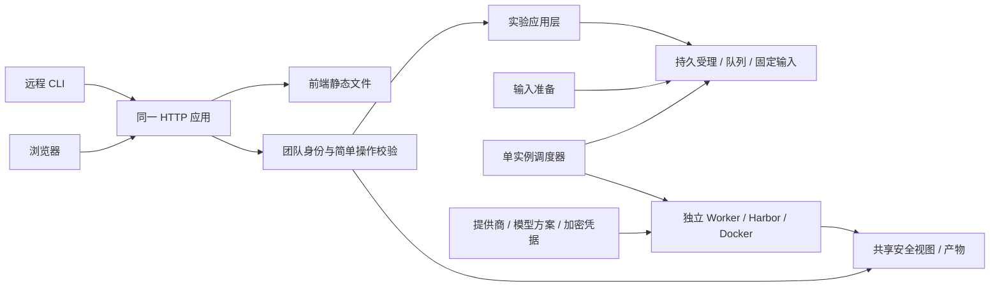

# 轻量团队共享实验服务：CLI 与 Web

本页保留该阶段的通用设计讨论；设计、实现和实际验收结论分别记录。

服务为一个受邀可信团队提供共享实验空间：CLI 和 Web 使用同一 API、持久队列与运行记录，所有成员都能查看全部实验结果。个人身份用于提交归属、问题追踪、使用统计与取消权限。现有 Harbor 执行、快照、评分、对比和清理继续复用。

## 1. 目的、场景与成功标准

成员使用现成团队登录进入服务，选择团队可用的数据集版本、模型方案和候选 bundle，提交实验。关闭网页或终端后任务继续；重新登录可查看团队全部状态、脱敏日志、报告与产物，比较实验，或按原快照重跑。

成功标准：

- CLI 提交的实验在 Web 可看、可操作，Web 提交的实验在 CLI 可看、可操作，两入口共享容量与业务规则。
- 所有登录成员看到同一批团队实验；提交者字段用于归属与操作判断，不作为结果可见性过滤条件。
- 成员能提交和取消自己提交的任务；管理员能取消任何任务、删除产物、管理提供商/凭据/模型方案与容量。
- 成员 B 重跑成员 A 的实验，产生归 B 名下的独立记录并保留 parent，不修改 A 的记录。
- 同时配置多个提供商和同一提供商的多个 key，通过模型方案明确选择；密钥值不出现在 API 响应、日志、快照或产物中。
- 一个可配置监听地址/端口的 HTTP 服务提供 API 与构建后的前端；无需项目内的证书、域名或反向代理配置即可用 IP/端口访问。
- 提交重试不重复执行；重启可恢复队列与收尾；评分明确区分有效零分、缺失和执行失败。

## 2. 已确认要求、实施取舍与边界

| 类别 | 结论 |
| --- | --- |
| 已确认受众 | 仅受邀可信团队；无开放注册 |
| 已确认身份 | 保留个人身份和提交者，复用可用团队登录；仅成员/管理员的简单操作区分 |
| 已确认共享 | 全体成员查看全部实验、日志、报告、产物；无 private 实验或成员间结果隔离 |
| 已确认模型接入 | 团队共用，多提供商、多 key；提供商、凭据、模型方案分别管理；管理员管理 key |
| 已确认前端 | Vite + React + shadcn/ui + Tailwind CSS；构建静态文件与 API 同一 HTTP 服务，API 相对路径 |
| 已确认部署边界 | 服务只提供 HTTP，host/port 可配置；HTTPS、Nginx、证书和域名由部署环境另行处理 |
| 已确认可靠性 | 幂等、持久队列、取消/恢复、全局并发/资源限制、配置固定、执行前凭据检查 |
| 建议实现起点 | 单机 Linux/Docker、FastAPI、SQLite、文件快照、独立输入准备/调度进程和既有 Worker |
| 不在首版 | 个人 key、复杂角色/组织体系、多机调度、自研执行沙箱、key 自动负载均衡、计费平台 |

受众、共享方式、共用凭据和前端/HTTP边界已确定，不再作为待决问题。仍待落实的是现成团队登录的具体接口、首批提供商协议类型、机器容量及保留策略。这些属于实施配置/适配事项，不重新引入首版之外的功能。

开发投入和运行成本未给定。墙钟、并发、CPU/内存、尝试次数、队列及上传限制是资源控制，不能称为准确金额预算。使用统计记录提交/尝试数量、状态和实际可观测时长；token 或费用字段标明来源，未知值保留 unknown，reported cost=0 不作为免费证明。

## 3. 对外边界、输入输出与操作行为

### 团队身份与共享操作

复用现成团队登录取得可靠的成员 ID、显示名及管理员标记，不另建密码体系或多级权限，沿用其会话与浏览器操作请求保护。提交者由服务端从登录身份填写，不能接受浏览器自行声明的 user_id。邀请资格仍须校验；不能用一个可任填的名字替代身份验证。

所有成员可列表、筛选、查看任何团队实验、受理记录、日志、报告与产物；按提交者筛选只是使用便利。取消与删除在 API 再次校验，不能只隐藏按钮。成员可以取消自己的准备中、排队或运行任务；管理员可以取消任何任务。

所有成员可基于任意团队实验 rerun。新记录归当前提交者，parent 指向原实验；原任务/评分来源、模型非秘密配置、bundle 和环境快照保留，当前资格与可用团队凭据重新校验。不能把原作者身份或旧登录会话复制到新实验。

成员退出网页登录只结束访问会话，已受理任务继续。会话到期不等于模型凭据到期；凭据不可用或成员资格撤销时，尚未启动任务在执行边界明确失败，活动任务正常收尾或由管理员取消。

### 提供商、凭据与模型方案

| 对象 | 保存内容 | 对外作用 |
| --- | --- | --- |
| 提供商配置 | 稳定 ID、名称、协议/适配类型、endpoint、非秘密选项、配置版本及启用状态 | 表明调用哪个服务，不保存 key |
| 凭据 | 稳定 ID、提供商 ID、管理员标签、版本、启用/撤销/可选到期状态及密文 | 同一提供商可有多个 key；值只供执行/审计内部读取 |
| 模型方案 | 稳定 ID/版本、提供商引用、凭据引用、served model ID、模型参数和运行默认值 | 成员提交时选择的完整方案，不由成员拼装 endpoint 与 key |

模型方案的凭据必须属于其引用的提供商，不匹配时拒绝保存。首版方案明确引用一个提供商和一个凭据；多个 key 可供不同方案使用，不增加自动 key 池、故障切换或暗中换供应商。接入复用 Harbor/OpenCode 的成熟适配，不宣称任意供应商协议天然兼容；首批支持范围在适配时验证。

管理员可以新增、更新、停用提供商和方案，新增/轮换/停用凭据。密钥写入接口只接受一次输入，返回 ID/标签/状态，不提供读取明文的接口。前端保存后清空输入，不把 key 写进本地持久存储或反填已有值；请求日志不记录秘密输入。成员目录只展示方案和必要的非秘密服务信息。

凭据建议以认证加密密文存入数据库；主密钥来自数据库及实验目录之外、服务账号拥有的 0600 受保护文件，由服务运行环境提供。加密在写数据库前完成，数据库/WAL/备份中不得出现明文值；主密钥不随数据库备份、日志或产物导出。保护数据库不能提供 HTTP 传输加密，传输层保护由部署环境决定和承担。

轮换创建新版本，新受理实验使用当前版本；已受理实验保留其绑定的版本，不自动切换。管理员显式停用/撤销旧版本后，其未启动任务不再执行，活动任务仍需原来源完成审计。被运行/日志引用的旧密文仅保留供审计，不作为新提交的回退 key；有依赖时拒绝物理删除并说明原因，不谎称已彻底抹除。

### 提交、固定配置与观察

输入是固定 dataset 引用、可选任务过滤、模型方案或显式 oracle、已准备 bundle 引用及资源参数。受理时固定方案版本、提供商版本、模型 ID/参数和实验默认值，并绑定凭据 ID/版本；Hub 解析后固定 dataset/task digest 与字节快照。记录凭据引用，不在实验快照里保存密钥或其密文。之后修改方案、endpoint、默认数据集或 key 不改变已受理实验。

输入准备使用持久受理记录：HTTP 202 返回 submission_id 与 preparing，run_id 初始为空。准备完成才形成可运行 run/queued，失败或取消不会留下可执行孤儿。客户端对同一次提交复用幂等键；同一用户和操作下同键同内容返回原记录，同键不同内容返回冲突。主动 rerun 是新操作，可以创建新记录。

执行前检查绑定的提供商/凭据版本是否仍允许执行、可解密、匹配提供商且未到期，并重新检查提交者资格。未通过时明确未执行失败，不启动模型，不回退 oracle/其他 key/新方案。检查本地可用性不等于已验证远端认证。

rerun 固定原实验的非秘密模型与实验配置；可绑定同一凭据的当前可用版本并记录新引用，原 run 审计来源不变。若原配置已禁止执行或没有匹配可用凭据，则拒绝并要求显式新提交，不静默修改提供商/模型。纯 key 轮换作为审计元数据记录；可比性仍依据实际模型、提供商、参数、来源和环境条件。

状态、报告与产物信息对全团队共享。查询只读取安全视图，不启动/停止调度器或修改终态。后台校验原评分器结果并发布报告，合法 0 分、缺评分和异常分开显示；跨数据集或条件不匹配不生成聚合改进结论。

日志按所属 run 的凭据来源脱敏后返回纯文本。缺审计来源时，所有成员都看到同样的审计不完整提示，保留安全状态和摘要，暂不交接无法确认安全的原文。这是凭据保护，不是按成员划分 private 结果。

产物通过文件 ID 下载，不接受客户端宿主路径，不在同源页面执行产物 HTML。管理员只可删除终态且清理确认后的产物文件；不能删除重跑输入、评分记录或审计依赖。删除记录保留操作者和时间，重复删除幂等，详情明确显示已删除；成员无删除权限。

## 4. Web 页面、CLI 与 HTTP 边界

Web 首版有五个页面：

1. **团队实验列表**：全部实验、提交者、数据集、模型方案、状态与时间；按提交者筛选和简单使用统计。
2. **新建实验**：数据集/版本、任务范围、方案、bundle 与资源参数，提交前显示最终选择。
3. **实验详情**：准备/排队/运行阶段、脱敏日志、逐题报告和产物；取消按钮按提交者/管理员显示，任何成员可重跑。
4. **实验对比**：选择任意两个团队 run；可比时显示差值，不可比时先显示原因。
5. **管理设置**：提供商、各提供商的多个凭据、模型方案、容量与后台健康。密钥输入一次、保存后不可读回；管理员可删除符合条件的产物。

前端确定采用 Vite + React + shadcn/ui + Tailwind CSS。构建后的静态文件由 API 所在 HTTP 应用提供，生产运行不依赖 Vite 开发服务器或单独 Node 后端。页面请求使用相对路径，如 `/api/v1/runs`，构建产物不写死域名/IP，也不需要跨域配置。

SPA 页面 `/runs/<id>` 刷新返回前端页面；`/api/*` 请求走 API，错误也返回 JSON，不能被 SPA fallback 吞掉。静态资源缺失返回正确错误。首版周期刷新状态与有界脱敏日志，显示刷新时间/断线状态；不引入 SSE/WebSocket。

HTTP 服务的监听地址与端口可配置，例如 `http://127.0.0.1:8000`；监听到合适网卡后可直接通过机器 IP/端口访问。服务不内置 HTTPS，不生成证书，不重定向到 HTTPS，也不安装或配置 Nginx/域名。部署环境如需代理或传输加密，自行提供；这不改变相对路径的 API 契约。

远程 CLI 保留 submit/list/status/logs/report/cancel/compare/rerun 与 human/`--json`，只增加服务地址/profile 和团队登录入口。示意而非已实现命令：

```text
harbor-helper service login --url http://<机器IP>:<端口>
harbor-helper submit --dataset <固定Hub引用> --model-profile <方案ID>
harbor-helper status <run-id>
```

服务 profile 固定地址和成员身份；连接失败明确失败，不能静默退回本地执行。本地 CLI 的既有功能可独立保留，不把旧 HOME/team 凭据会话当作服务成员身份。服务模式下成员只选择团队模型方案，不管理个人 key。

## 5. 模块职责与协作接口



| 责任 | 输入 → 输出 | 边界 |
| --- | --- | --- |
| 团队身份/操作校验 | 已验证成员 + 动作 → 允许/拒绝 | 读取全共享；取消判断提交者，管理动作判断管理员，无复杂结果隔离 |
| 提供商/凭据/方案 | 管理员配置 → 可选方案与版本 | 配置、秘密、成员选择分开；秘密不回传、不通过请求进程全局环境切换 |
| 实验应用层 | actor + 类型化参数 → 受理/run | 统一归属、幂等、固定配置、取消/rerun语义，不渲染页面或终端 |
| 输入准备 | 受理记录 → 固定任务/bundle 或失败 | 有界下载/上传，不在全局调度锁中等待网络，不启动模型 |
| 调度/Worker | 队列 + 全局限制 → 执行/收尾 | 独立进程、启动前资格和凭据检查、精准清理与审计后放容量 |
| 报告/产物 | run → 共享安全视图/文件 | 指标由原 verifier 决定；读取无副作用，删除不破坏固定输入 |
| CLI/Web | 同一 API 数据 → 展示与操作 | 不自行计分、不直接写队列或访问宿主路径 |

通用服务层不依赖 CAD 评分、任务文本或具体指标；继续通过 Harbor 原生 task/verifier 接口协作。

## 6. 实现选择、兼容与代价

建议 FastAPI 应用同时提供 `/api/v1` 和静态文件；SQLite 保存受理、队列、提交者、提供商/方案版本和加密凭据元数据，文件系统保存固定输入/产物。复用成熟认证加密实现，例如 AES-GCM，并以凭据/提供商/版本身份绑定密文。具体库版本和现成团队登录适配在实施时锁定；不自研密码/加密算法。

一个独立输入准备进程、一个调度进程和现有独立 Worker 共用服务 state。API 退出不终止实验；数据库事务、唯一约束与锁保证幂等、单实例和容量，不为每个用户另起一套 state。无需 Redis/Celery/Kubernetes。

凭据解析只按 run 引用和用途返回内部内存值；只把匹配 key 交给该 Worker 的受控环境。当前 `runtime_context` 使用进程级 HOME/env，不能直接在并发 HTTP 请求中复用。主密钥缺失/错误时明确不可解密，相关执行拒绝，审计受影响时保留 cleanup_blocked，不使用旧环境中的 key 兜底。

现有 CLI 查询可能启动调度器，report 可能写文件/修正状态。服务版先提取应用服务并分离后台校验/只读视图，避免直接调用 CLI main 或拼 shell。后台健康/恢复由管理员管理，成员查询不承担运维副作用。

服务使用专用 state，既有本地记录先保留。需要导入时，管理员明确操作，旧记录可标注历史提交者未知并团队共享查看，不自动归当前用户，不改旧 manifest。服务归属只控制新任务取消和统计，不新增读取隔离。

主要投入是应用服务提取、模型接入三对象、凭据保护、队列可靠性和统一视图；UI 在 API 契约稳定后实现。运行资源限制与统计均不承诺准确费用控制。

## 7. 分期结果与评审事项

| 阶段 | 可评审交付 | 放行条件 |
| --- | --- | --- |
| 1. 契约与应用层 | 团队身份/共享操作、三对象、固定快照及 API 契约 | 当前草案与服务验收标准完成评审；原本地入口边界明确 |
| 2. HTTP API + 远程 CLI | 登录到提交/观察/取消/报告/compare/rerun；多提供商/多key | 假 key 与真实进程验证、队列恢复、无串用、容量统一 |
| 3. 同服务 Web | 确定的前端栈与五页，静态文件/API统一HTTP | IP/端口可用、相对API路径、团队共享、操作权限正确 |
| 4. 团队试用 | 简单数据集跨CLI/Web全流程、恢复/备份说明 | 真人体验及无模型可靠性验收；真实模型验证另有预算授权 |

[服务验收标准](service-acceptance.md) 将每项要求转成可验证条件。当前只交评审文档，不开始实现或部署。登录适配、首批协议、容量和保留参数在实施计划中明确，不再提出个人凭据或开放注册方向。

## 实现草图（接口仍可在评审中调整）

拟提取应用服务并注入 actor、存储、方案解析与凭据用途；保留本地 CLI 兼容入口，API 与远程 CLI 使用同一应用结果。GET 返回共享安全 DTO，不暴露宿主绝对路径、PID、密钥明文或密文。

| 暂定接口 | 约定 |
| --- | --- |
| GET /api/v1/me、/catalog、/usage | 个人身份、团队方案/数据集、实际可观测的团队/按提交者统计，无秘密 |
| POST /api/v1/submissions | 幂等键 + dataset/model_profile/bundle/资源参数 → 202 preparing；提交者服务端填写 |
| GET /api/v1/submissions/{id} | 全成员可看准备状态、错误与关联 run_id |
| POST /api/v1/submissions/{id}/cancel | 提交者或管理员取消准备；不能留下可执行孤儿 |
| GET /api/v1/runs、/runs/{id}/logs、/report | 全成员共享分页、状态、有界脱敏日志和报告 |
| POST /api/v1/runs/{id}/cancel | 提交者或管理员；重复请求不重复停止其他任务 |
| POST /api/v1/runs/{id}/rerun | 全成员可用；幂等的新受理记录归当前成员，保留 parent |
| POST /api/v1/compare | 任意两条团队记录 → 可比结果或原因 |
| POST /api/v1/bundles | 有界上传 → 内容摘要/引用，按既有契约拒绝路径穿越/链接/凭据类文件 |
| GET /api/v1/runs/{id}/artifacts/{file_id} | 全成员下载安全产物，不接受宿主路径 |
| DELETE /api/v1/runs/{id}/artifacts/{file_id} | 仅管理员；须终态/清理确认，保留删除标记，不删除来源/报告 |
| /api/v1/admin/providers、/credentials、/model-profiles、/limits | 仅管理员变更；凭据创建/轮换只写秘密，查询只返元数据 |

统一错误为 code/message/request_id/retryable。未登录401，无操作权403，记录不存在404，幂等或生命周期冲突409，已删除产物410，参数错误422，队列/请求限额429，暂不可用503。API错误返回JSON；详细异常不得包含秘密。浏览器请求使用相对路径，CLI 的服务地址来自 profile。

| 决定 | 原因 | 可见效果 | 可能实现位置 |
| --- | --- | --- | --- |
| 全共享 + 提交者归属 | 团队共同观察且能追踪使用 | 全量可见，取消/统计按身份，重跑归当前人 | Store提交者字段、应用动作校验与统计 |
| 提供商/凭据/模型方案分离 | 多服务多key需明确选择 | 成员只选方案，管理员独立管理key | 配置版本与方案解析模块 |
| 加密凭据 + DB外主密钥 | 数据库不能存明文key | 查询无密钥值，备份不携带解密主密钥 | 成熟加密库、受保护主密钥来源 |
| 持久受理/幂等/固定快照 | 输入准备耗时且HTTP会重试 | 可追踪、不会重复执行或受配置变化影响 | 受理存储、准备进程、唯一约束 |
| 单调度器与Worker专属环境 | 同机容量和key选择须一致 | 两入口共享限制，任务间不混key | runs/worker与凭据用途接口 |
| 同一HTTP应用/相对API | IP/端口直接使用且部署轻量 | 无内置HTTPS/域名/CORS配置依赖 | FastAPI静态文件、Vite构建与路由 |
